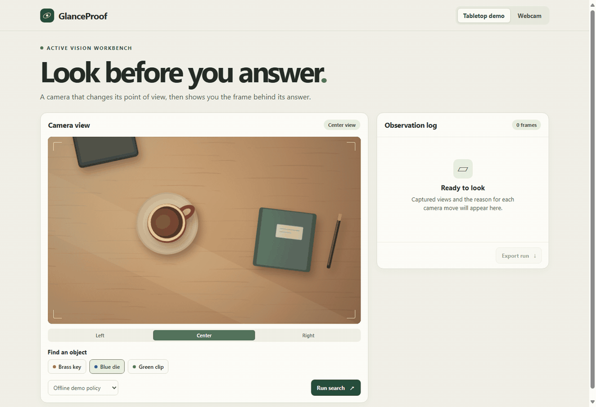

# GlanceProof

Give a vision assistant a camera it can ask to move. When the first view misses the target, the assistant seeks another view and links its answer to the frame that supports it.

[简体中文](docs/README.zh-CN.md)



## Try it

Run with Node.js 22 or later. The app has no package dependencies.

```sh
node server.mjs
```

Open [the local workbench](http://127.0.0.1:4173). Choose **Blue die**, then **Run search**. The first frame misses the die. The simulated camera moves across the tabletop, and the answer links to **Frame 3**. Click any frame to inspect it or export the run as JSON with its captured images and decisions.

## Use GPT

Copy `.env.example` to `.env`, set `OPENAI_API_KEY`, and restart the server. The default model is `gpt-5.4-mini`. Set `OPENAI_MODEL` to use another Responses API model with image input and structured outputs.

- In **Tabletop demo**, select **GPT** to let the model pick between the remaining desk views. In **Offline demo policy**, a deterministic rule uses the fixture’s field of view. The three predefined targets start outside the first frame.
- In **Webcam**, turn on the camera, enter a question, and click **Capture & ask**. When GPT requests a different angle, move the camera and click **Capture next frame**. The run allows up to four captured views.

The server listens on loopback. The webcam preview runs locally. GPT runs send selected captures to the [OpenAI Responses API](https://developers.openai.com/api/docs/guides/images-vision); the API key stays on the server. The app keeps frames in memory until the run is cleared or the page closes. An exported run contains those images. Frame citations link to the model’s claimed evidence for human inspection.

## Run the tests

```sh
node --test
```

The tests cover all three offline targets, the bounded camera request, and citation validation against a stubbed OpenAI response.

Run the [blind tabletop benchmark](benchmark/README.md) to measure supported answers, correct abstentions and wrong-frame citations on six held-out scenes with occlusions, similar objects and absent targets.

## Related work

- [realtime-gpt4o-videochat](https://github.com/basvandorst/realtime-gpt4o-videochat) pairs webcam frames with voice questions.
- [OpenVision](https://github.com/rayl15/OpenVision) connects smart glasses to local and cloud AI, including OpenAI.
- [Roz](https://github.com/calz1/roz) uses vision models to describe changes detected by a webcam.
- [ViewAgent](https://github.com/mll-lab-nu/ViewAgent) studies interactive view planning with a 6-DoF camera benchmark.
- [ActiveVLA](https://github.com/ZhenyangLiu/ActiveVLA-Injecting-Active-Perception-into-VLA) uses view selection and zoom for robot manipulation.

GlanceProof packages the observation, movement request, and evidence frame in a workbench you can try on a laptop. A physical pan-tilt camera is the next milestone for the tabletop movement loop.

## License

[MIT](LICENSE)
