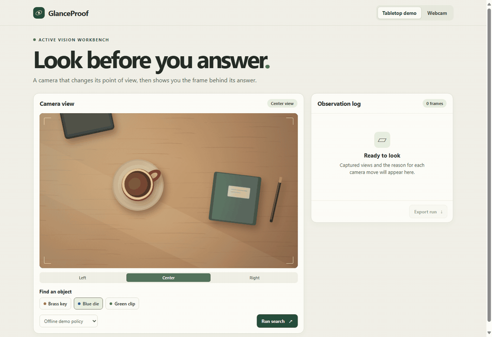

# GlanceProof · 主动视觉工作台

让 GPT 根据画面决定下一步往哪看。找到目标后，点击答案里的帧编号，就能检查它依据的画面。

[English](../README.md)

[桌面场景盲测](../benchmark/README.md)包含六个独立的合成场景，覆盖遮挡、相似物和目标缺席，并汇报有证据的正确答案、正确弃答和引错帧的次数。



## 免密钥体验

在项目目录中用 Node.js 22 或更高版本启动服务，无需安装依赖。

```powershell
node server.mjs
```

打开 [本地工作台](http://127.0.0.1:4173)，选 **Blue die** 并点击 **Run search**。蓝色骰子在初始取景范围之外。虚拟摄像头会先转向左侧，再转向右侧，并在答案中引用第 3 帧。右侧可以回看每次取景，也可以通过 **Export run** 下载包含图片和决策的 JSON 文件。

桌面演示还有黄铜钥匙和绿色回形针。三个目标都预先放在首帧之外。默认离线策略通过模拟视野判断目标是否可见，这组结果用于展示流程。

## 让 GPT 参与取景

1. 把 `.env.example` 复制为 `.env`，在本机填入 `OPENAI_API_KEY`，重启服务。默认模型为 `gpt-5.4-mini`。
2. 在 **Tabletop demo** 中将决策引擎切换为 **GPT**，即可让模型读取画面并选择下一个虚拟视角。
3. 在 **Webcam** 中开启摄像头，输入诸如「红色马克杯在哪里？」的问题，点击 **Capture & ask**。如果 GPT 请求换角度，按提示手动移动摄像头，再点 **Capture next frame**。每次最多采集四帧。

摄像头预览在浏览器本地运行，GPT 模式向 OpenAI 提交采集的帧。密钥由本地服务读取。导出的 JSON 包含截图。模型引用的是它自己判断有用的帧，可以点开检查。

## GitHub 上的相近项目

表中 Star 数来自 2026 年 11 月 27 日查询的 GitHub 仓库数据。

| 项目 | Star | 已有能力 |
| --- | ---: | --- |
| [realtime-gpt4o-videochat](https://github.com/basvandorst/realtime-gpt4o-videochat) | 41 | 摄像头截图和语音问答 |
| [OpenVision](https://github.com/rayl15/OpenVision) | 227 | 智能眼镜接入 OpenAI 等模型 |
| [Roz](https://github.com/calz1/roz) | 5 | 识别摄像头前的变化并播报 |
| [ViewAgent](https://github.com/mll-lab-nu/ViewAgent) | 27 | 交互式视角规划和六自由度评测 |
| [ActiveVLA](https://github.com/ZhenyangLiu/ActiveVLA-Injecting-Active-Perception-into-VLA) | 31 | 为机器人操作选择视角并放大目标 |
| [LeRobot](https://github.com/huggingface/lerobot) | 29,121 | 机器人学习、数据采集与硬件工具链 |

项目的切入点是让人直接体验「首帧缺证据 → 换视角 → 引用画面作答」，还可以检查每次动作和每张截图。下一步是让桌面模式里的取景指令驱动实际云台，再用新画面完成验证。

## 许可

[MIT](../LICENSE)
